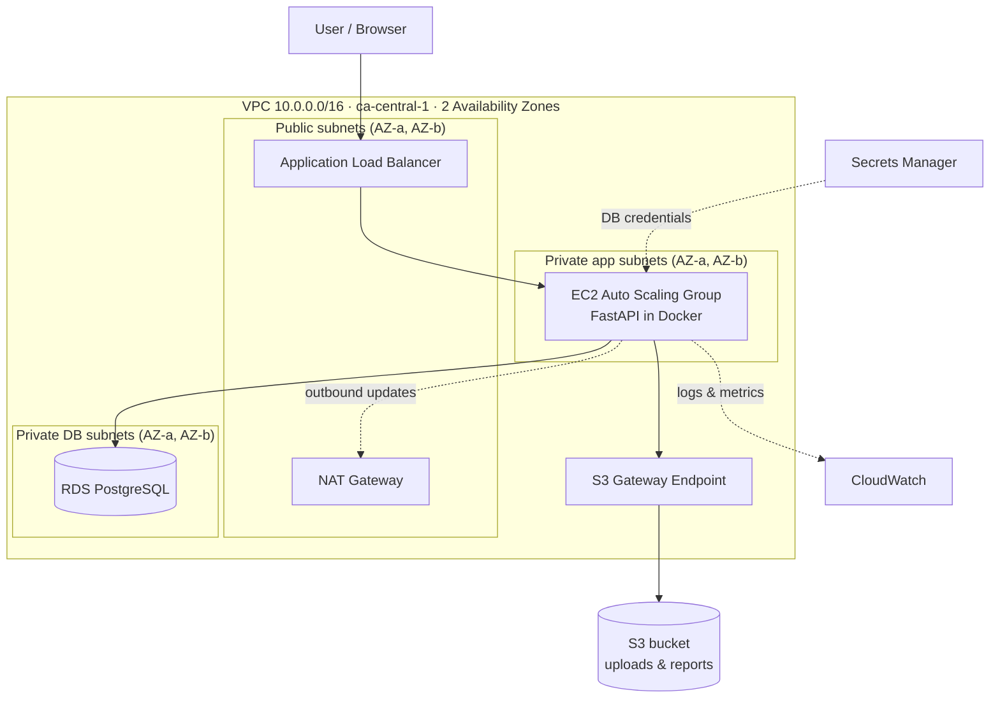

# EngOps Portal — AWS 3-Tier Architecture with Terraform

> **How to use this file**
> Put this file in the root of a new GitHub repo named `aws-3tier-engops-portal`.
> Claude Code reads `CLAUDE.md` automatically. Start with:
> *"Read CLAUDE.md. We're starting Phase 0, Step 1. Explain the plan before writing anything."*

---

## 0. Who this is for

**Karthik (owner):** You will be interviewed on this project. Every file, resource and decision
here must be something you can explain out loud. Claude Code builds *with* you, not *for* you.

**Claude Code:** You are pairing with Karthik, a new-grad Cloud/DevOps developer
(AWS Certified Cloud Practitioner, preparing for Solutions Architect – Associate).
He is learning Terraform as we go. Your job is to build this project **and teach him**.

---

## 1. Why this project exists

1. **Make the resume true.** Karthik's resume lists this project:
   > *AWS 3-Tier Cloud Architecture — EC2, ALB, RDS, S3, VPC, IAM, Terraform*
   > - *Architected a scalable 3-tier AWS stack with least-privilege IAM roles, VPC subnets, and security groups.*
   > - *Automated full provisioning with Terraform (IaC) for version-controlled, reproducible deployments.*

   **Phase 0 must deliver every word of those two bullets, exactly.** Nothing else matters until it does.

2. **Prepare for a DevOps interview at an engineering consulting firm.** The team does internal
   workflow automation for mechanical/electrical engineers (keeping Revit running well,
   optimizing engineering processes). Phase 1 adds features aimed at that kind of work.
   We do **not** know the firm's actual pain points yet. Don't invent them; build general,
   realistic examples and keep them easy to adapt.

3. **Stay consistent with karthikeyanumesh.com.** The site currently lists Terraform under
   "Currently learning" and has no card for this project. Once Phase 0 is done, the site
   gets a project card that says exactly where the project stands (the site's rule:
   *"Every card says where the project actually stands."*).

---

## 2. Non-negotiable rules (Claude Code, read twice)

1. **Teach as you go.** Before each step: what we're building and why. After each step:
   a 3–5 line plain-English recap Karthik could repeat in an interview.
2. **Never run anything that costs money without asking.** No `terraform apply`,
   `terraform destroy`, or AWS CLI write commands until Karthik types "yes" for that run.
   Always show `terraform plan` output first and estimate the hourly/monthly cost.
3. **No secrets in code or Git.** No access keys, passwords or API keys in any file.
   Use AWS Secrets Manager, environment variables and `.gitignore`. Commit
   `terraform.tfvars.example`, never `terraform.tfvars`.
4. **Least privilege everywhere.** Every IAM policy names specific actions and resources.
   No `"Action": "*"` or `"Resource": "*"` unless AWS truly requires it, and then comment why.
5. **Small commits, conventional messages** (`feat:`, `fix:`, `docs:`, `infra:`).
6. **Write an ADR** (Architecture Decision Record) in `docs/adr/` for every meaningful
   choice (e.g. "one NAT gateway instead of two"). These are interview gold.
7. **Only claim what works.** README and resume wording must describe what is actually
   deployed and tested. If something is mocked or planned, label it.
8. **Karthik runs the AWS-touching commands himself** when possible, so he learns them.

---

## 3. Cost safety (do this first, before any infrastructure)

- Region: **`ca-central-1` (Canada Central)**. Talking point: Canadian data residency.
- Create an **AWS Budgets alert** at a low threshold (e.g. $10/month) with email notification.
- Biggest cost risks: **NAT Gateway** (charged hourly even when idle, roughly $30+/month if
  left running), **RDS** (check free-tier eligibility on Karthik's account), **ALB** (hourly).
- Workflow: `apply` → demo/test → `destroy` the same day. The whole point of Terraform is
  that rebuilding takes one command.
- Tag every resource: `Project=engops-portal`, `Owner=karthik`, `Env=dev`, `ManagedBy=terraform`.

---

## 4. Architecture (Phase 0)



**The three tiers:**

| Tier | What | Lives in |
|---|---|---|
| Presentation | ALB (HTTP; HTTPS optional if a domain/cert is available) serving the app's web UI | Public subnets |
| Application | FastAPI app in Docker on EC2, Auto Scaling Group (min 1, max 2) | Private app subnets |
| Data | RDS PostgreSQL + S3 bucket | Private DB subnets / S3 |

**Security group chain** (the core interview answer):
- `alb-sg`: inbound 80/443 from the internet.
- `app-sg`: inbound app port **only from `alb-sg`**.
- `db-sg`: inbound 5432 **only from `app-sg`**.
- No SSH. No public IPs on EC2. Admin access via **SSM Session Manager**.

**IAM (least privilege):**
- EC2 instance role: read/write only the project S3 bucket prefix, read only the DB secret,
  pull only from the project ECR repo, write CloudWatch logs, SSM core.
- CI/CD role: assumed by GitHub Actions via **OIDC** (no long-lived AWS keys in GitHub).

---

## 5. The app (kept simple on purpose)

**EngOps Portal**: a small internal tool for an engineering team.

Phase 0 features:
- `GET /health` for ALB health checks.
- A simple request tracker: engineers log tool/workflow issues ("Revit crashes on file X",
  "need a new template"). Create, list, update status. Stored in **RDS PostgreSQL**.
- Attach a file to a request → stored in **S3**, metadata in RDS.
- Minimal HTML UI (FastAPI + Jinja templates). Function over design.

Stack: Python 3.12, FastAPI, SQLAlchemy, Alembic (migrations), Pydantic, pytest, Docker.
(Karthik already knows FastAPI, Pydantic and Docker from his Resume Tailor project.)

---

## 6. Repo structure

```
aws-3tier-engops-portal/
├── CLAUDE.md
├── README.md                  # architecture diagram, how to deploy/destroy, costs
├── docs/
│   ├── adr/                   # 0001-region.md, 0002-single-nat.md, ...
│   └── interview-notes.md     # Karthik's own explanations (he writes these)
├── bootstrap/                 # one-time, never destroyed: Terraform state bucket + budget (ADR 0002)
├── infra/
│   ├── modules/
│   │   ├── network/           # VPC, subnets, IGW, NAT, route tables, S3 endpoint
│   │   ├── security/          # security groups, IAM roles/policies
│   │   ├── compute/           # launch template, ASG, ALB, target group
│   │   ├── data/              # RDS, DB subnet group, S3 bucket
│   │   └── monitoring/        # CloudWatch alarms, log groups, SNS
│   └── envs/dev/              # main.tf, variables.tf, outputs.tf, backend.tf
├── app/
│   ├── src/  tests/  Dockerfile  requirements.txt
└── .github/workflows/
    ├── terraform-ci.yml       # fmt, validate, tflint, checkov, plan on PRs
    └── app-ci.yml             # pytest, docker build, push to ECR on main
```

---

## 7. Phase 0 — build plan (REQUIRED FIRST)

Each step ends with: working code, a commit, a recap for Karthik, and his checkpoint questions.

**Step 1 — Setup & safety.** AWS CLI profile (Karthik configures credentials himself),
Budgets alert, `bootstrap/` remote state in S3 (Terraform ≥ 1.10 native S3 locking with
`use_lockfile = true`, or a DynamoDB lock table on older versions).
*Checkpoint: Why remote state? What happens if two people apply at once?*

**Step 2 — Network module.** VPC, 2 AZs, public/private-app/private-DB subnets, IGW,
one NAT gateway (ADR: cost vs. high availability), route tables, S3 gateway endpoint.
*Checkpoint: Why do private subnets need a NAT? Why is the DB subnet separate from the app subnet?*

**Step 3 — Security module.** The three security groups (chained), EC2 instance role,
instance profile, least-privilege policies.
*Checkpoint: Walk through how a request reaches the database and which rule allows each hop.*

**Step 4 — Data module.** RDS PostgreSQL (small instance, encrypted, not publicly
accessible, credentials managed in Secrets Manager), private S3 bucket (block public access,
encryption, versioning).
*Checkpoint: How does the app get the DB password without it being in code?*

**Step 5 — App.** FastAPI app, tests, Dockerfile. Runs locally with Docker Compose + local
Postgres first. Then ECR repo, image push.
*Checkpoint: What does the health check endpoint do for the ALB?*

**Step 6 — Compute module.** Launch template (user data: install Docker, pull image from
ECR, read secret, run container), Auto Scaling Group across both private subnets,
ALB + target group + listener.
*Checkpoint: What happens when an instance fails its health check?*

**Step 7 — Monitoring.** CloudWatch log group for the app, alarms (ALB 5xx, unhealthy
hosts, RDS free storage, EC2 CPU), SNS email topic.
*Checkpoint: Which alarm fires first if the app crashes?*

**Step 8 — CI/CD.** GitHub Actions with OIDC: Terraform fmt/validate/tflint/Checkov/plan
on pull requests; app tests + image build/push on main. `apply` stays manual
(`workflow_dispatch`) with Karthik's approval.
*Optional:* a `Jenkinsfile` mirroring the app pipeline (Karthik trained on Jenkins in AWS re/Start).
*Checkpoint: Why OIDC instead of storing AWS keys in GitHub secrets?*

**Step 9 — Prove it.** Full `apply` from zero → use the app through the ALB → screenshot
→ `destroy` → `apply` again to prove reproducibility. README with diagram, costs,
deploy/destroy commands, and screenshots.

### Phase 0 definition of done (maps to the resume)
- [ ] "Scalable 3-tier AWS stack" → ALB + ASG across 2 AZs + RDS, working end to end
- [ ] "Least-privilege IAM roles" → scoped instance role + OIDC CI role, no wildcards
- [ ] "VPC subnets, and security groups" → 6 subnets, chained SGs, no public EC2
- [ ] "Automated full provisioning with Terraform" → one `terraform apply` builds everything
- [ ] "Version-controlled, reproducible deployments" → in Git, CI runs plan, destroy/re-apply proven
- [ ] Karthik can draw the architecture from memory and answer every checkpoint question

---

## 8. Phase 1 — extensions for engineering-team workflow automation (ONLY after Phase 0)

These target what an internal DevOps team at an engineering consulting firm does:
automating engineers' workflows and keeping design tools like Revit healthy.

### 1A. Revit Model Health Pipeline
- A **pyRevit / Revit API (Python)** script that exports model health data from a Revit file:
  file size, warning count, element/family counts, linked models, last-saved info → JSON.
- JSON is posted to a new portal endpoint → stored in RDS, raw file in S3.
- Portal dashboard: model health trends per project, flags (e.g. warnings rising week over week).
- **Reality check:** Revit runs on Windows and needs a licence (check Autodesk's free trial or
  education access). Until it's tested against real Revit, use sample JSON fixtures in
  `samples/revit/` and label the feature "tested with sample data" everywhere.
- Stretch: look into Autodesk Platform Services (APS) cloud APIs as an alternative.

### 1B. Engineering Knowledge Assistant (RAG)
- Ingest internal-style documents (Karthik writes sample SOPs/how-tos, or uses public
  government documents; **no proprietary or copyrighted documents**).
- Chunk → embed (Gemini embeddings API, which Karthik has used) → store in **pgvector**
  on the same RDS PostgreSQL (one database, no new service to pay for).
- `POST /ask` returns an answer **with citations** to the source chunks.
- Talking point: why pgvector on existing RDS instead of a separate vector database.

### 1C. MCP Server
- A small **MCP server** (official MCP Python SDK) exposing read-only tools:
  `search_requests`, `get_model_health(project)`, `ask_standards(question)`.
- Lets an AI assistant (e.g. Claude) query the portal safely.
- Auth via API key stored in Secrets Manager; read-only by design (ADR: why).

### 1D. Optional, only if job research says it's relevant
- MongoDB Vector Search as an alternative to pgvector (compare in an ADR).
- AutoCAD automation (Karthik used AutoCAD for CAD drawings in his bachelor's).

**Update this section** after Karthik talks to people on the team. Real pain points beat guesses.

---

## 9. Interview talking points (Karthik fills these in himself, in his own words)

In `docs/interview-notes.md`, answer:
1. Draw the architecture and explain each tier in 60 seconds.
2. How does a request flow from browser to database? Which rule allows each hop?
3. Why one NAT gateway? What would you change for production?
4. How do you manage Terraform state and prevent conflicting applies?
5. How are secrets handled?
6. What does least privilege look like in your IAM policies? Show one.
7. How would you make this production-ready? (Multi-AZ RDS, HTTPS, WAF, two NATs, backups.)
8. What broke while building it, and how did you fix it? (Keep a running log. This is
   the best interview story you'll have.)

---

## 10. After Phase 0: sync everything

- [ ] Website: add a project card with honest status (e.g. "Completed · deployed and tested,
      destroyed between demos to save cost"), stack tags, repo link, screenshots.
- [ ] Website: move Terraform out of "Currently learning" only once Phase 0 is done.
- [ ] Resume: keep the existing bullets (they're now true). Add Phase 1 bullets only for
      features that actually run.
- [ ] GitHub: pin the repo; README first screen = diagram + one-paragraph summary.
