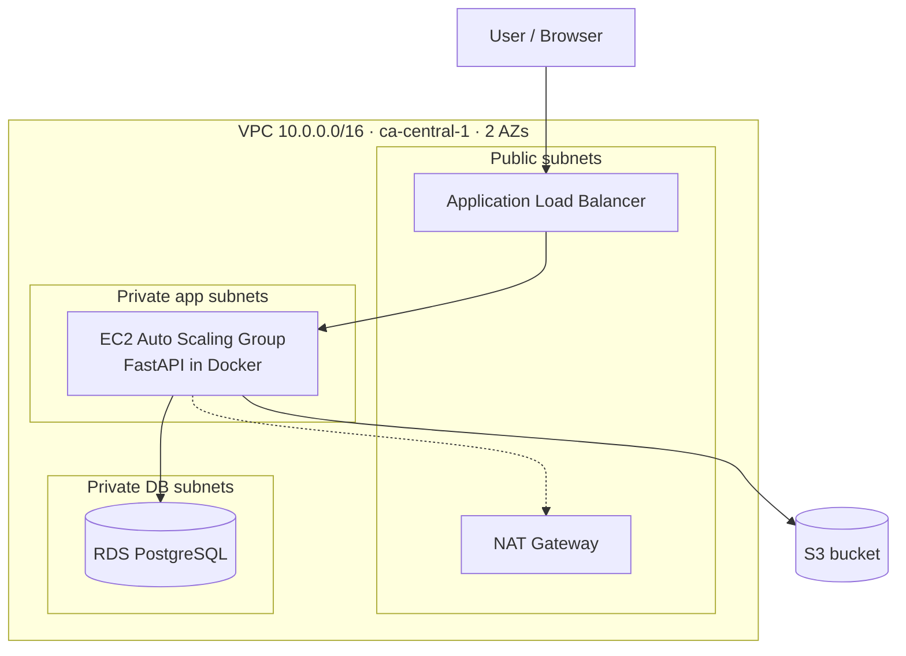

# EngOps Portal: AWS 3-Tier Architecture with Terraform

> **Status: 🚧 Phase 0 in progress. Nothing is deployed yet.**
> This README only describes what actually works. Planned items are labelled *planned*.

An internal request tracker for engineering teams ("Revit crashes on file X", "need a new template"),
deployed as a 3-tier stack on AWS (`ca-central-1`) and provisioned entirely with Terraform.

## Architecture (planned)



| Tier | Component | Subnets |
|---|---|---|
| Presentation | Application Load Balancer | Public |
| Application | FastAPI in Docker on EC2 (Auto Scaling Group) | Private app |
| Data | RDS PostgreSQL + S3 | Private DB / S3 |

## Progress

| Step | Description | Status |
|---|---|---|
| 0 | Repo scaffold | ✅ Done |
| 1 | Setup & safety (budget alert, remote state) | ⏳ Next |
| 2 | Network module | Planned |
| 3 | Security module | Planned |
| 4 | Data module | Planned |
| 5 | App (FastAPI + Docker) | Planned |
| 6 | Compute module (ALB + ASG) | Planned |
| 7 | Monitoring | Planned |
| 8 | CI/CD (GitHub Actions + OIDC) | Planned |
| 9 | Full apply → test → destroy → re-apply | Planned |

## Repo layout

```
bootstrap/       one-time: S3 bucket for Terraform remote state
infra/modules/   network, security, compute, data, monitoring
infra/envs/dev/  the dev environment that wires the modules together
app/             FastAPI application, tests, Dockerfile
docs/adr/        Architecture Decision Records
```

## Cost

Deploy, test, then destroy on the same day. Cost estimates will be added as each module is built.
