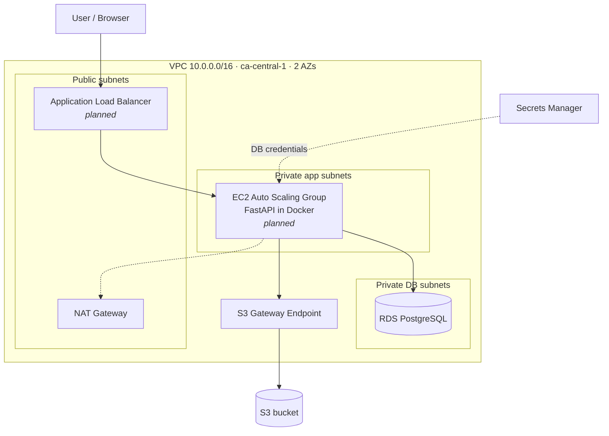

# EngOps Portal: AWS 3-Tier Architecture with Terraform

> **Status: 🚧 Phase 0 in progress (Steps 1–4 of 9 done).**
> The network, security and data tiers are written in Terraform and have been deployed, checked
> in the AWS console, and destroyed. The app, compute tier, monitoring and CI/CD are *planned*.
> This README only describes what actually works.

An internal request tracker for engineering teams ("Revit crashes on file X", "need a new template"),
deployed as a 3-tier stack on AWS (`ca-central-1`) and provisioned entirely with Terraform.

## Architecture



| Tier | Component | Subnets | Status |
|---|---|---|---|
| Presentation | Application Load Balancer | Public | Planned (Step 6) |
| Application | FastAPI in Docker on EC2 (Auto Scaling Group) | Private app | Planned (Steps 5–6) |
| Data | RDS PostgreSQL + S3 | Private DB / S3 | ✅ Built and tested |

### Security group chain

```
Internet --80--> [alb-sg] --8000--> [app-sg] --5432--> [db-sg]
                 from 0.0.0.0/0     only from alb-sg    only from app-sg
```
Outbound traffic is restricted too. The ALB can only reach the app, the app can only reach the DB
plus HTTPS to AWS APIs, and the DB has no outbound rules. No SSH: admin access is through SSM Session Manager.

## What's built

| Step | Description | Status |
|---|---|---|
| 0 | Repo scaffold | ✅ Done |
| 1 | Bootstrap: S3 remote-state bucket (native locking) + AWS Budgets alerts | ✅ Deployed, **running** (≈ $0/month) |
| 2 | Network: VPC, 6 subnets across 2 AZs, IGW, single NAT (switchable), S3 gateway endpoint | ✅ Deployed, tested, destroyed |
| 3 | Security: chained security groups, least-privilege EC2 role + instance profile | ✅ Deployed, tested, destroyed |
| 4 | Data: RDS PostgreSQL (private, encrypted, RDS-managed secret) + private S3 bucket | ✅ Deployed, tested, destroyed |
| 5 | App (FastAPI + Docker + ECR) | ✅ Done: app tested locally (SQLite) with 18 passing tests; GitHub Actions tests, builds and pushes the image to ECR via OIDC (local Docker blocked by a WSL bug, see ADR 0007) |
| 6 | Compute (launch template, ASG, ALB) | ✅ Deployed: app served through the ALB, target healthy, container logs in CloudWatch, password read from Secrets Manager |
| 7 | Monitoring (CloudWatch alarms, SNS email) | ⏳ In progress: code written, not yet deployed |
| 8 | CI/CD (GitHub Actions + OIDC) | Planned |
| 9 | Full apply → test → destroy → re-apply, with screenshots | Planned |

**Running in AWS right now:** only the bootstrap layer (state bucket, budget, ECR repo, GitHub OIDC role). The dev environment
is destroyed between sessions to save cost.

## Deploy and destroy

Prerequisites: Terraform ≥ 1.10, AWS CLI with a profile named `engops`.

```powershell
# One-time (already done): remote state bucket + budget alerts
cd bootstrap
Copy-Item terraform.tfvars.example terraform.tfvars   # set budget_alert_email
terraform init; terraform apply

# Dev environment
cd ..\infra\envs\dev
$env:AWS_PROFILE = "engops"
Copy-Item terraform.tfvars.example terraform.tfvars   # set alb_ingress_cidrs to your IP /32
terraform init
terraform plan -out=tfplan
terraform apply tfplan          # prints app_url

# Tear down (bootstrap is separate and stays)
terraform destroy
```

## Cost

| Resource | Approx. cost while deployed (ca-central-1) |
|---|---|
| Bootstrap (state bucket, budget) | ≈ $0/month, always on |
| VPC, subnets, route tables, IGW, S3 endpoint, security groups, IAM | Free |
| NAT Gateway + Elastic IP | ≈ $0.055/hr (off by default for now) |
| RDS db.t4g.micro + 20 GB gp3 | ≈ $0.02/hr |
| Secrets Manager (1 secret) | ≈ $0.40/month, prorated |

Workflow: apply → test → destroy the same day. Budget alerts fire at $1 and $10.

## Architecture decisions

| ADR | Decision |
|---|---|
| [0001](docs/adr/0001-region-ca-central-1.md) | Region: ca-central-1, for Canadian data residency |
| [0002](docs/adr/0002-remote-state-and-bootstrap-layer.md) | S3 remote state with native locking; budget lives in a never-destroyed bootstrap layer |
| [0003](docs/adr/0003-single-nat-gateway.md) | One NAT Gateway instead of one per AZ (cost vs. HA) |
| [0004](docs/adr/0004-ssm-instead-of-ssh.md) | SSM Session Manager instead of SSH or a bastion host |
| [0005](docs/adr/0005-db-credentials-rds-managed-secret.md) | RDS-managed DB password in Secrets Manager, never in code or state |
| [0006](docs/adr/0006-liveness-vs-readiness-health-checks.md) | ALB health check doesn't depend on the database (liveness vs. readiness) |
| [0007](docs/adr/0007-ecr-in-bootstrap-immutable-tags.md) | ECR in bootstrap, immutable commit-ID tags, images built in CI |
| [0008](docs/adr/0008-github-oidc-for-ci.md) | GitHub Actions uses OIDC (no stored AWS keys), scoped to this repo's main branch |
| [0009](docs/adr/0009-compute-asg-alb-restricted-ingress.md) | ASG behind an ALB with ELB health checks, CPU scaling, IMDSv2; ALB open to my IP only |

## Known gaps (what I'd tighten for production)

- S3 gateway endpoint uses AWS's default full-access endpoint policy. The IAM role still limits the app,
  but production would also restrict the endpoint policy to the project's buckets.
- Single NAT Gateway, single-AZ RDS (cost tradeoffs, see ADR 0003).
- HTTP only (no domain/certificate yet). The app has no user authentication.
- Migrations run at container start. Production would run them as a separate deploy step.
- ECR scan-on-push reports 4 HIGH CVEs, all in Debian base-image libraries (glibc, zlib) from
  `python:3.12-slim`, none in app dependencies. Production would rebuild on a schedule to pick up
  patched base images, and fail CI above a severity threshold.
- GitHub Actions are pinned to major version tags. Production would pin them to commit SHAs.

## Repo layout

```
bootstrap/       one-time, never destroyed: Terraform state bucket + budget alerts
infra/modules/   network, security, data (built) · compute, monitoring (planned)
infra/envs/dev/  the dev environment that wires the modules together
app/             FastAPI application, tests, Dockerfile (planned)
docs/adr/        Architecture Decision Records
```
