# EngOps Portal: AWS 3-Tier Architecture with Terraform

> **Status: ✅ Phase 0 complete.** Deployed with one `terraform apply`, used end to end through the load
> balancer, crash-tested (self-healing + alarm email), destroyed, and rebuilt from zero with no manual steps.
> The stack is **destroyed between demos** to keep cost near zero. This README only describes what actually works.

An internal request tracker for engineering teams ("Revit crashes on file X", "need a new template")
running on a three-tier AWS stack in `ca-central-1`. An **Application Load Balancer** in public subnets
sends traffic to a **FastAPI container on an EC2 Auto Scaling Group** in private subnets, which stores data in
**RDS PostgreSQL** (isolated database subnets) and **S3**. Everything (VPC, security groups, least-privilege IAM,
compute, data, alarms) is **Terraform** with remote state. The app image is built and pushed by GitHub Actions,
and every infrastructure change goes through a pull request with fmt, validate, tflint, a Checkov security scan
and a read-only plan. CI authenticates to AWS with **OIDC**, so no AWS keys are stored anywhere.

## Architecture

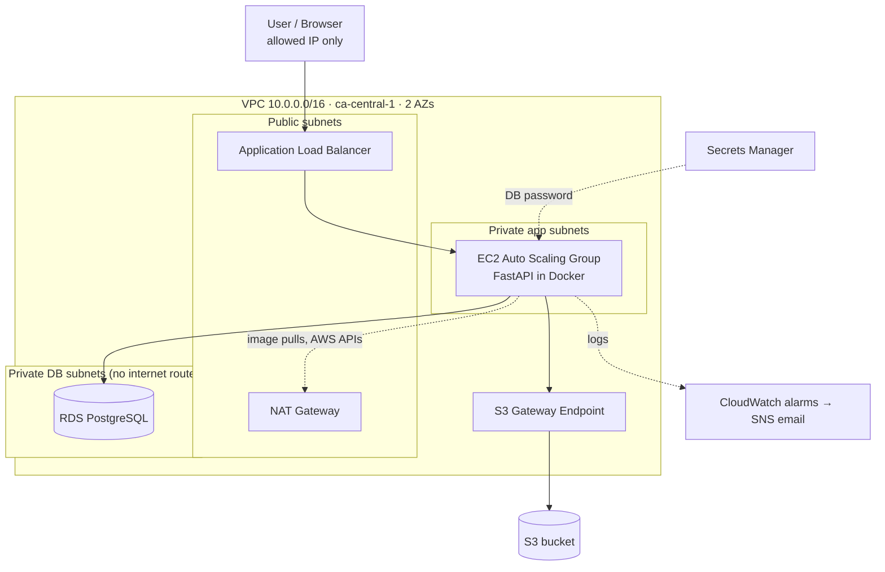

| Tier | Component | Subnets |
|---|---|---|
| Presentation | Application Load Balancer (HTTP, restricted to allowed IPs) | Public |
| Application | FastAPI in Docker on EC2 (Auto Scaling Group, min 1 / max 2, CPU target tracking) | Private app |
| Data | RDS PostgreSQL (encrypted, not public) + S3 (private, encrypted, versioned) | Private DB / S3 |

### Security group chain

```
Allowed IP --80--> [alb-sg] --8000--> [app-sg] --5432--> [db-sg]
                                only from alb-sg    only from app-sg
```
Outbound traffic is restricted too. The ALB can only reach the app, the app can only reach the DB plus HTTPS
to AWS APIs, and the DB has no outbound rules. No SSH and no public IPs on EC2: admin access is through SSM.

## Proof (Step 9, 2026-11-08)

| | |
|---|---|
| 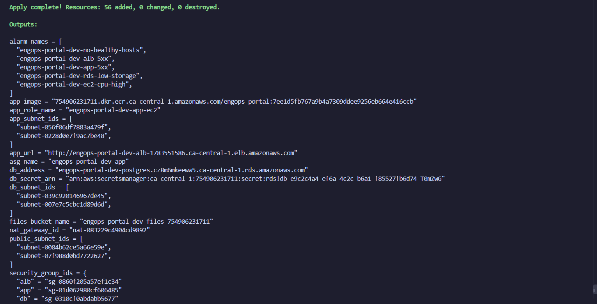 **1. One `terraform apply` builds all 56 resources** | 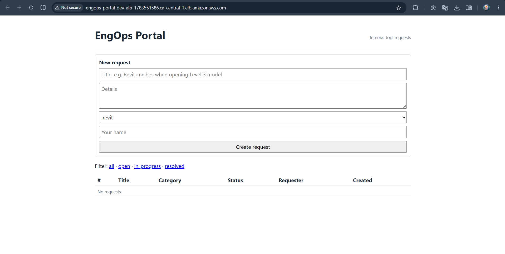 **2. App served through the ALB** |
| 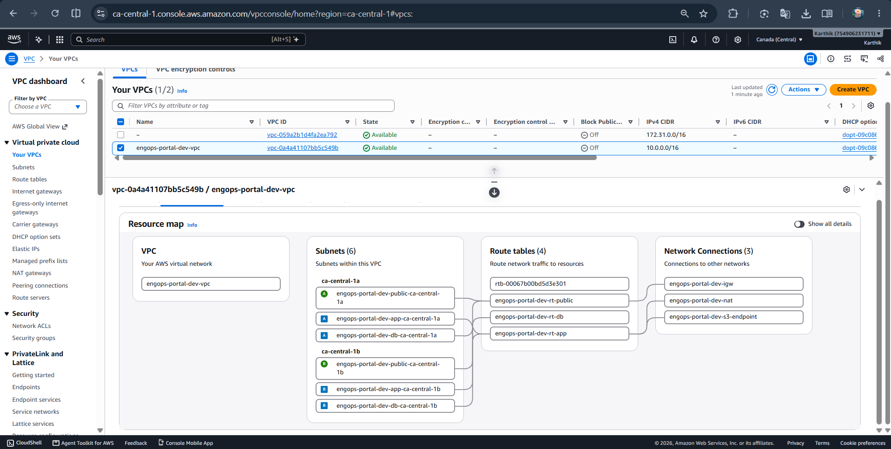 **3. VPC: 6 subnets in 2 AZs, 4 route tables, IGW, NAT, S3 endpoint** | 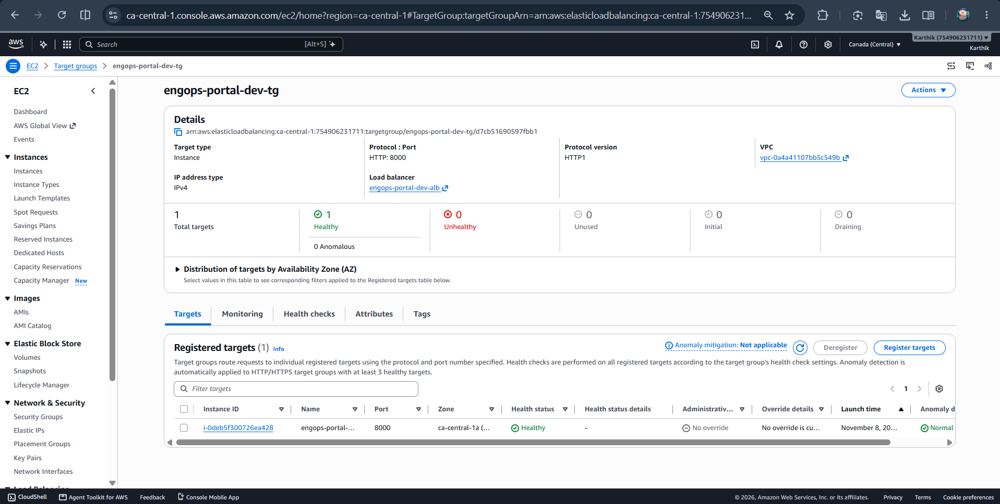 **4. ALB target healthy (`/health`)** |
| 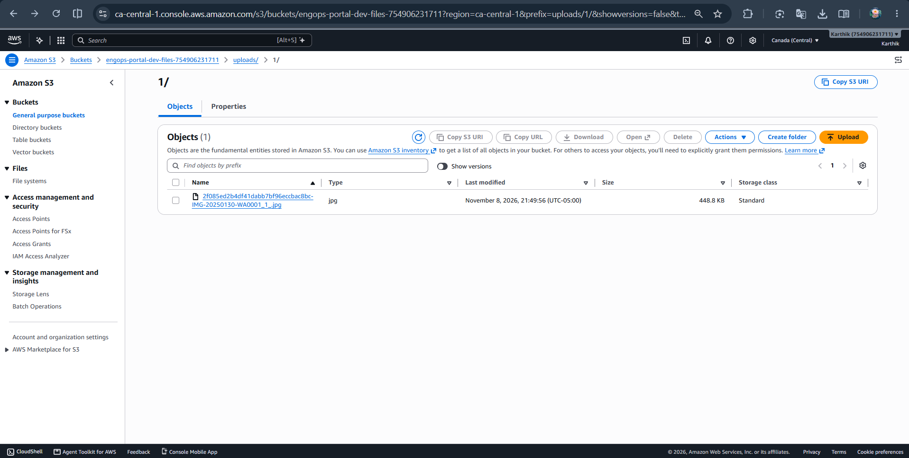 **5. Attachment stored in S3 under `uploads/`** | 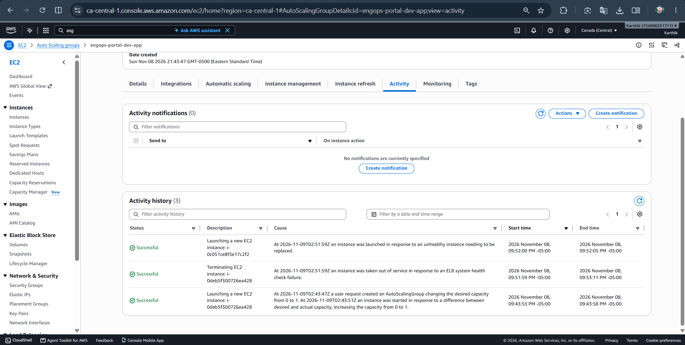 **6. Self-healing: container stopped → ELB health check failed → ASG replaced the instance** |
| 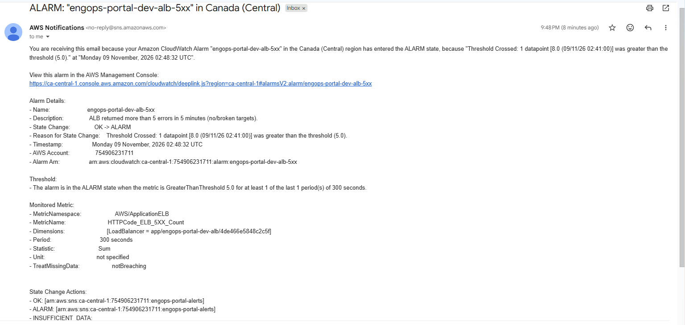 **7. CloudWatch alarm emailed through SNS** | 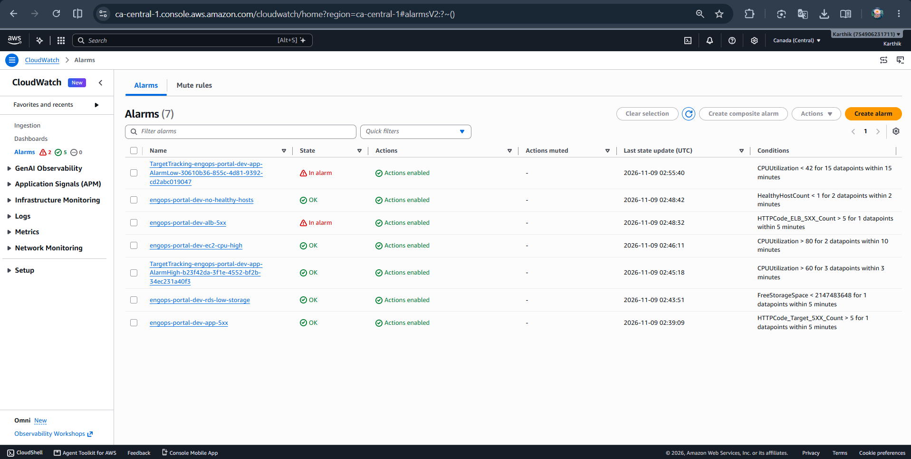 **8. Alarms (5 project + 2 from target tracking)** |
| 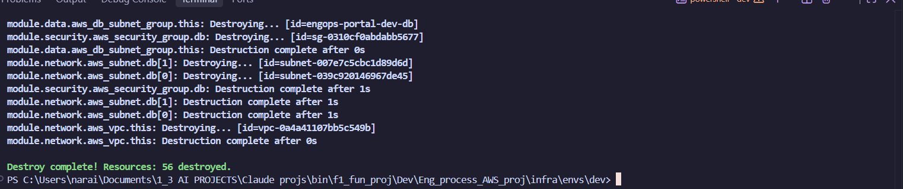 **9. `terraform destroy`: 56 destroyed** | 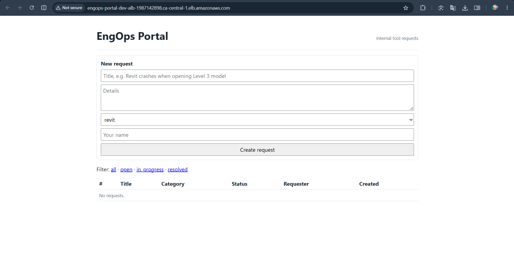 **10. Re-applied from zero: new ALB, app back** |
| 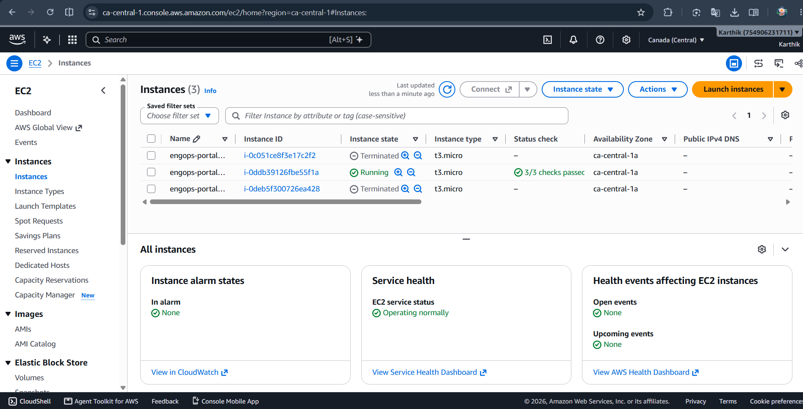 **11. Fresh instance running after re-apply (earlier ones terminated)** | |

## Phase 0 definition of done

| Resume claim | Evidence | |
|---|---|---|
| "Scalable 3-tier AWS stack" | ALB + Auto Scaling Group (1–2 instances, CPU target tracking) across 2 AZs + RDS, used end to end | ✅ |
| "Least-privilege IAM roles" | EC2 role scoped to 2 S3 prefixes, 1 ECR repo, 1 log group, 1 secret; OIDC CI roles (push-only and read-only plan); remaining `*` actions are ones AWS can't scope, commented in code | ✅ |
| "VPC subnets, and security groups" | 6 subnets (public / private app / private DB), chained SGs, no public EC2, DB subnets with no internet route | ✅ |
| "Automated full provisioning with Terraform" | One `terraform apply` builds all 56 dev resources | ✅ |
| "Version-controlled, reproducible deployments" | Git + PR checks with plan in CI; destroyed and re-applied from zero (screenshots 9–11) | ✅ |

## Build log

| Step | Description | Status |
|---|---|---|
| 0 | Repo scaffold | ✅ |
| 1 | Bootstrap: S3 remote state (native locking), budget alerts, alerts SNS topic, ECR, GitHub OIDC roles | ✅ Running permanently (≈ $0/month) |
| 2 | Network: VPC, 6 subnets across 2 AZs, IGW, single NAT, S3 gateway endpoint | ✅ |
| 3 | Security: chained security groups, least-privilege EC2 role + instance profile | ✅ |
| 4 | Data: RDS PostgreSQL (private, encrypted, RDS-managed secret) + private S3 bucket | ✅ |
| 5 | App: FastAPI + SQLAlchemy + Alembic, 18 pytest tests, Docker image built by CI and pushed to ECR | ✅ |
| 6 | Compute: launch template (IMDSv2), Auto Scaling Group, ALB, target group | ✅ |
| 7 | Monitoring: 5 CloudWatch alarms → SNS email (email delivery verified) | ✅ |
| 8 | CI/CD: app pipeline + Terraform PR checks (fmt, validate, tflint, Checkov, read-only plan), all via OIDC; first infra change merged through [PR #1](https://github.com/naraianlegrand/aws-3tier-engops-portal/pull/1) | ✅ |
| 9 | Full apply → use → crash test → destroy → re-apply, with screenshots | ✅ |

**Running in AWS right now:** only the bootstrap layer (state bucket, budget, alerts topic, ECR repo,
GitHub OIDC roles), about $0/month. The dev environment exists only during demos.

## What broke (and how I fixed it)

- **Docker Desktop wouldn't start** (WSL error `0x8007273f`). I traced it to a missing Hyper-V socket provider,
  then moved image builds to GitHub Actions, which is how teams ship images anyway (ADR 0007).
- **CI couldn't assume its AWS role.** GitHub sends an *immutable* OIDC subject with numeric owner/repo IDs;
  my trust policy expected the name-only format. I matched the real claim, which is also safer (ADR 0008).
- **First ASG creation failed with "Access denied"** on the auto-created service-linked role (propagation race in
  a new account). The activity log showed AWS's retry succeeded, so I used `terraform untaint` instead of rebuilding.
- **App URL timed out.** `terraform.tfvars` still had the documentation placeholder IP, so the ALB security group
  dropped my traffic while the target was healthy. Timeout = network rule; 502/503 = app.
- **ECR showed 3 entries per push and no scan results.** Modern `docker build` pushes an index + attestation bundle;
  building one plain `linux/amd64` image fixed scanning and the lifecycle rule.
- **Checkov flagged my own CI plan role** for `*` on actions that can be scoped. I scoped them instead of skipping the check.

## Deploy and destroy

Prerequisites: Terraform ≥ 1.10, AWS CLI with a profile named `engops`.

```powershell
# One-time: state bucket, budget, alerts topic, ECR, GitHub OIDC roles
cd bootstrap
Copy-Item terraform.tfvars.example terraform.tfvars   # set budget_alert_email
terraform init; terraform apply                        # then confirm the SNS email once

# Dev environment
cd ..\infra\envs\dev
$env:AWS_PROFILE = "engops"
Copy-Item terraform.tfvars.example terraform.tfvars   # set alb_ingress_cidrs to your IP /32
terraform init
terraform plan -out=tfplan      # 56 to add
terraform apply tfplan          # ~12 min (mostly RDS); prints app_url

# Tear down (bootstrap is separate and stays)
terraform destroy
```

## Cost

| Resource | Approx. cost while deployed (ca-central-1) |
|---|---|
| Bootstrap (state bucket, budget, SNS, ECR, IAM) | ≈ $0/month, always on |
| VPC, subnets, route tables, IGW, S3 endpoint, security groups, IAM | Free |
| NAT Gateway + Elastic IP | ≈ $0.055/hr |
| ALB (+ its public IPs) | ≈ $0.035/hr |
| EC2 t3.micro | ≈ $0.012/hr |
| RDS db.t4g.micro + 20 GB gp3 | ≈ $0.02/hr |
| **Whole dev stack** | **≈ $0.12–0.15/hr**, only while deployed |

Workflow: apply → demo → destroy the same day. Budget alerts fire at $1 and $10.

## Architecture decisions

| ADR | Decision |
|---|---|
| [0001](docs/adr/0001-region-ca-central-1.md) | Region: ca-central-1, for Canadian data residency |
| [0002](docs/adr/0002-remote-state-and-bootstrap-layer.md) | S3 remote state with native locking; budget lives in a never-destroyed bootstrap layer |
| [0003](docs/adr/0003-single-nat-gateway.md) | One NAT Gateway instead of one per AZ (cost vs. HA) |
| [0004](docs/adr/0004-ssm-instead-of-ssh.md) | SSM Session Manager instead of SSH or a bastion host |
| [0005](docs/adr/0005-db-credentials-rds-managed-secret.md) | RDS-managed DB password in Secrets Manager, never in code or state |
| [0006](docs/adr/0006-liveness-vs-readiness-health-checks.md) | ALB health check doesn't depend on the database (liveness vs. readiness) |
| [0007](docs/adr/0007-ecr-in-bootstrap-immutable-tags.md) | ECR in bootstrap, immutable commit-ID tags, images built in CI |
| [0008](docs/adr/0008-github-oidc-for-ci.md) | GitHub Actions uses OIDC (no stored AWS keys), scoped to this repo's main branch |
| [0009](docs/adr/0009-compute-asg-alb-restricted-ingress.md) | ASG behind an ALB with ELB health checks, CPU scaling, IMDSv2; ALB open to my IP only |
| [0010](docs/adr/0010-terraform-ci-and-accepted-risks.md) | Terraform CI on PRs (fmt, validate, tflint, Checkov, plan) with a read-only OIDC role; accepted-risk register |

## Known gaps (what I'd change for production)

- HTTPS (ACM certificate + domain), user authentication, and WAF; then open the ALB beyond a single IP.
- Two NAT Gateways (one per AZ) and Multi-AZ RDS; deletion protection on.
- S3 gateway endpoint uses AWS's default full-access endpoint policy. The IAM role still limits the app,
  but production would also restrict the endpoint policy to the project's buckets.
- Migrations run at container start. Production would run them as a separate deploy step.
- Instances install Docker at boot. Production would bake an AMI or move to ECS/Fargate.
- ECR scan-on-push reports HIGH CVEs in Debian base-image libraries (glibc, zlib), none in app dependencies.
  Production would rebuild on a schedule and fail CI above a severity threshold.
- GitHub Actions are pinned to major version tags. Production would pin them to commit SHAs.
- Other accepted Checkov findings (cost, no certificate, destroyed each session) are listed with reasons in
  [ADR 0010](docs/adr/0010-terraform-ci-and-accepted-risks.md).

## Repo layout

```
bootstrap/          never destroyed: state bucket, budget, alerts SNS topic, ECR, GitHub OIDC roles
infra/modules/      network, security, data, compute, monitoring
infra/envs/dev/     the dev environment that wires the modules together
app/                FastAPI app, Alembic migrations, pytest tests, Dockerfile
.github/workflows/  app-ci (test → build → push to ECR), terraform-ci (PR checks + plan)
docs/adr/           Architecture Decision Records
docs/screenshots/   Step 9 proof
```
